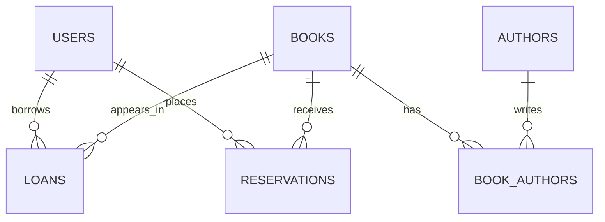

# Virtual Library

Virtual Library is a Java application being developed by Group 6 for the C211
team project. The application will allow users to browse a collection of books,
check out available books, return borrowed books, and view their account
information through a simple graphical user interface.

## Planned Features

- Store and manage a collection of books.
- Create and manage library user accounts.
- Allow each user to check out up to five books.
- Return books and make them available to other users.
- Search or browse the book collection.
- Use a simple Java graphical user interface.

## Planned Classes

- `Book` stores information about a book and its availability.
- `LibraryUser` stores account information and borrowed books.
- `Library` manages the book collection, users, checkouts, and returns.
- `LibraryGUI` provides the graphical interface and application testing code.

The final class assignments may change as the team develops the project.

## Contributors

- Astrid Kalenga
- Brionna Morris
- [Mubarak Russell](https://github.com/mrussell-iu)

## Current Status

The project has completed its initial proposal and planning phases. Phase 2
defines the database structure, important use cases, and query requirements.

## Database Purpose

The Virtual Library database will store books, authors, library users, loans,
and reservations. It must support everyday library actions such as finding a
book, checking whether a user can borrow another book, recording returns, and
identifying overdue loans.

The design assumes that each physical book record represents one copy that can
be borrowed by one user at a time. A user may have no more than five active
loans. A book may have multiple authors, and an author may write multiple
books.

## Proposed Database Tables

### Users

- `UserID`: unique identifier and primary key
- `FirstName`: user's first name
- `LastName`: user's last name
- `Email`: unique email address
- `AccountStatus`: active, suspended, or closed
- `MaxBooks`: maximum number of simultaneous loans, normally five

### Books

- `BookID`: unique identifier and primary key
- `ISBN`: unique ISBN when available
- `Title`: book title
- `PublicationYear`: year the book was published
- `Category`: subject or genre
- `AvailabilityStatus`: available, checked out, or reserved

### Authors

- `AuthorID`: unique identifier and primary key
- `FirstName`: author's first name
- `LastName`: author's last name

### BookAuthors

- `BookID`: foreign key referencing `Books`
- `AuthorID`: foreign key referencing `Authors`
- The combination of `BookID` and `AuthorID` is the primary key.

### Loans

- `LoanID`: unique identifier and primary key
- `UserID`: foreign key referencing `Users`
- `BookID`: foreign key referencing `Books`
- `CheckoutDate`: date the book was borrowed
- `DueDate`: date the book must be returned
- `ReturnDate`: actual return date, or null if the loan is active
- `LoanStatus`: active, returned, or overdue

### Reservations

- `ReservationID`: unique identifier and primary key
- `UserID`: foreign key referencing `Users`
- `BookID`: foreign key referencing `Books`
- `ReservationDate`: date the reservation was created
- `ReservationStatus`: active, fulfilled, or canceled

## ER Diagram



## Phase 2 Use Cases and Queries

### Use Case 1 Find Available Books

**Objective:** Allow a user to browse books that are currently available,
optionally filtering by category.

**Assumptions:** The `AvailabilityStatus` field is updated whenever a book is
checked out, returned, or reserved.

**Expected output:** A list of book IDs, titles, publication years, and
categories.

```sql
SELECT BookID, Title, PublicationYear, Category
FROM Books
WHERE AvailabilityStatus = 'available'
  AND Category = [specified_category]
ORDER BY Title;
```

**Importance:** Users need to know which books they can borrow immediately.

### Use Case 2 Display a User's Active Loans

**Objective:** Show every book currently checked out by a specific user,
including its checkout and due dates.

**Assumptions:** An active loan has a null `ReturnDate` and a status of
`active` or `overdue`.

**Expected output:** A list of book titles and loan dates for one user.

```sql
SELECT Books.Title, Loans.CheckoutDate, Loans.DueDate, Loans.LoanStatus
FROM Loans
COMBINE Books ON Loans.BookID = Books.BookID
WHERE Loans.UserID = [specified_user]
  AND Loans.ReturnDate IS NULL
ORDER BY Loans.DueDate;
```

**Importance:** Users and staff must be able to review current checkouts and
upcoming due dates.

### Use Case 3 Identify Overdue Books and Borrowers

**Objective:** Find active loans whose due dates have passed and identify the
users responsible for returning those books.

**Assumptions:** The current date is later than the due date, and the book has
not been returned.

**Expected output:** A report containing the borrower's name and email, book
title, and due date.

```sql
SELECT Users.FirstName, Users.LastName, Users.Email,
       Books.Title, Loans.DueDate
FROM Loans
COMBINE Users ON Loans.UserID = Users.UserID
COMBINE Books ON Loans.BookID = Books.BookID
WHERE Loans.DueDate < CURRENT_DATE
  AND Loans.ReturnDate IS NULL
ORDER BY Loans.DueDate;
```

**Importance:** Staff need this report to follow up on late returns and keep
books available to other users.

### Use Case 4 Check Whether a User May Borrow Another Book

**Objective:** Count a user's active loans before allowing another checkout.

**Assumptions:** The account must be active, the book must be available, and
the active-loan count must be below the user's `MaxBooks` value.

**Expected output:** The number of active loans and the user's borrowing limit.

```sql
SELECT COUNT(Loans.LoanID) AS ActiveLoanCount, Users.MaxBooks
FROM Users
COMBINE Loans ON Users.UserID = Loans.UserID
WHERE Users.UserID = [specified_user]
  AND Users.AccountStatus = 'active'
  AND Loans.ReturnDate IS NULL
GROUP BY Users.MaxBooks;
```

**Importance:** This query enforces the system rule that a user may check out
no more than five books at one time.

### Use Case 5 Record and Confirm a Book Return

**Objective:** Mark an active loan as returned and make the book available
again.

**Assumptions:** The specified loan exists, belongs to the book being returned,
and has not already been closed.

**Expected output:** A confirmation showing the updated loan and book status.

```sql
UPDATE Loans
SET ReturnDate = CURRENT_DATE,
    LoanStatus = 'returned'
WHERE LoanID = [specified_loan]
  AND ReturnDate IS NULL;

UPDATE Books
SET AvailabilityStatus = 'available'
WHERE BookID = [specified_book];
```

**Importance:** Correct return processing keeps loan history accurate and lets
another user borrow the book.

### Use Case 6 Search for Books by Author

**Objective:** Find all books written by a specified author.

**Assumptions:** The many-to-many relationship between books and authors is
stored in `BookAuthors`.

**Expected output:** A list of matching titles and their availability status.

```sql
SELECT Books.Title, Books.PublicationYear, Books.AvailabilityStatus
FROM Authors
COMBINE BookAuthors ON Authors.AuthorID = BookAuthors.AuthorID
COMBINE Books ON BookAuthors.BookID = Books.BookID
WHERE Authors.LastName = [specified_last_name]
ORDER BY Books.Title;
```

**Importance:** Author searches are a common way for users to find books.

### Use Case 7 View Active Reservations

**Objective:** Show active reservations for a specific book in the order they
were placed.

**Assumptions:** Only reservations with an `active` status are waiting to be
fulfilled.

**Expected output:** A chronological list of users waiting for the book.

```sql
SELECT Reservations.ReservationID, Users.FirstName,
       Users.LastName, Reservations.ReservationDate
FROM Reservations
COMBINE Users ON Reservations.UserID = Users.UserID
WHERE Reservations.BookID = [specified_book]
  AND Reservations.ReservationStatus = 'active'
ORDER BY Reservations.ReservationDate;
```

**Importance:** The reservation list ensures that waiting users receive access
to a returned book in a fair order.

## Diagram Updates and Rationale

The initial project plan described books, users, and library actions but did
not define a complete database structure. Phase 2 adds the following design
details:

- `Loans` is a separate entity rather than an attribute of a user or book. It
  preserves checkout history and stores checkout, due, and return dates.
- `Authors` and `BookAuthors` support the many-to-many relationship between
  books and authors without repeating author information in `Books`.
- `Reservations` records which user is waiting for which book and preserves
  the order in which requests were made.
- Status fields were added to users, books, loans, and reservations so the
  application can filter records without deleting historical information.
- `MaxBooks` was added to `Users` so the borrowing limit can be checked and
  changed without rewriting program logic.
- Unique values such as `UserID`, `BookID`, `ISBN`, and `Email` help prevent
  duplicate or ambiguous records.

These changes directly support the seven use cases and give the Java
application the information it needs for its graphical interface and business
rules.
